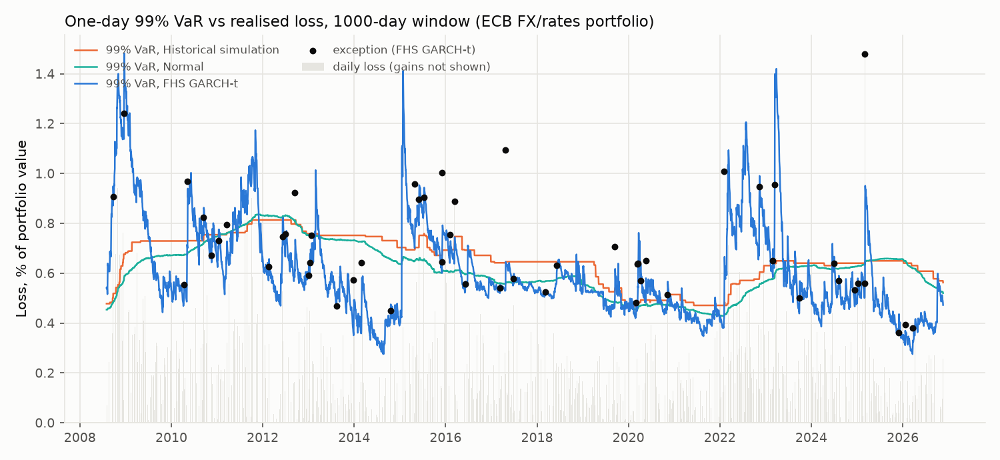
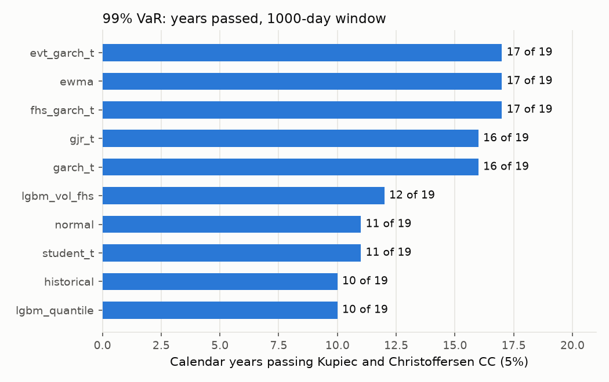

# Market risk: VaR/ES backtesting (Module B)

_Generated by `scripts/report.py` from `results/market/backtest/` (run 2026-11-21T14:39:59+00:00, arch 8.0.0). Not investment advice: this measures risk, it makes no return forecasts._

## Set-up

- **Portfolio** (EUR investor, ECB data only): fx_usd 20%, fx_gbp 10%, fx_jpy 10%, fx_chf 10%, bond_2y 20%, bond_10y 30%, rebalanced daily. FX positions are foreign-currency cash valued at the ECB reference rate; bonds are constant-maturity AAA zero-coupon positions on the ECB euro-area yield curve (return = −T·Δy + carry). Equities are not included: Stooq's terms were never cleared, so the plan's FX/rates fallback is used.
- **Data:** daily returns 2004-09-07 to 2026-11-19 (5,677 days). Portfolio daily SD 0.259%; worst day 2025-03-05 (loss 1.48%).
- **Protocol:** one-day forecasts for every day from 2008-08-01 (4,677 days), each from the previous 1000 days only (rolling window, re-estimated daily; ML models refitted every 20 days). All windows (250/500/1000) start forecasting on the same day, so every model is scored on identical days. Regimes were fixed in `config/market.toml` before the run.
- **Levels:** VaR 99% (Basel backtesting) and 97.5%; ES 97.5% (FRTB basis, BCBS MAR33.3).
- **Traffic light:** zones from the binomial CDF (green < 95%, red ≥ 99.99%); for 250 days at 99% this gives amber from 5 and red from 10 exceptions, matching the BCBS MAR32 table.

## 99% VaR, full sample (1000-day window, 4,677 days, 47 exceptions expected)

| Model | Exceptions | Rate | Kupiec p | Independence p | Cond. coverage p | Days in green / amber / red (trailing 250d) | Max exceptions in 250d |
|---|---|---|---|---|---|---|---|
| Historical simulation | 63 | 1.35% | 0.023 | <0.001 | <0.001 | 77% / 19% / 4% | 20 |
| Normal (variance-covariance) | 74 | 1.58% | <0.001 | <0.001 | <0.001 | 75% / 16% / 8% | 23 |
| Student-t (unconditional) | 49 | 1.05% | 0.745 | 0.002 | 0.006 | 83% / 13% / 4% | 17 |
| EWMA / RiskMetrics λ=0.94 | 61 | 1.30% | 0.046 | 0.249 | 0.070 | 70% / 30% / 0% | 8 |
| GARCH(1,1)-t | 35 | 0.75% | 0.070 | 0.267 | 0.105 | 90% / 10% / 0% | 6 |
| GJR-GARCH(1,1)-t | 37 | 0.79% | 0.136 | 0.301 | 0.193 | 90% / 10% / 0% | 6 |
| Filtered HS (GARCH-t) | 53 | 1.13% | 0.370 | 0.634 | 0.597 | 82% / 18% / 0% | 7 |
| Conditional EVT (GARCH-t + GPD) | 52 | 1.11% | 0.450 | 0.611 | 0.661 | 82% / 18% / 0% | 7 |
| LightGBM quantile (ML) | 124 | 2.65% | <0.001 | 0.066 | <0.001 | 31% / 47% / 23% | 14 |
| LightGBM volatility + FHS (ML) | 77 | 1.65% | <0.001 | 0.182 | <0.001 | 58% / 42% / 0% | 11 |

## 97.5% VaR and ES (1000-day window)

Z2 is the Acerbi–Szekely test 2 statistic: 0 if ES is right, negative if ES is too low; indicative zones > −0.70 green, > −1.8 amber. The residual test is a one-sided bootstrap on (L−ES)/ES on exception days (small p = ES too low). FZ0 is the joint VaR/ES scoring function (lower is better).

| Model | Exceptions | Rate | Kupiec p | Cond. coverage p | Z2 (zone) | ES residual p | FZ0 |
|---|---|---|---|---|---|---|---|
| Historical simulation | 132 | 2.82% | 0.166 | <0.001 | -0.17 (green) | 0.054 | -0.3316 |
| Normal (variance-covariance) | 130 | 2.78% | 0.229 | <0.001 | -0.26 (green) | <0.001 | -0.3197 |
| Student-t (unconditional) | 117 | 2.50% | 0.994 | <0.001 | +0.03 (green) | 0.869 | -0.3357 |
| EWMA / RiskMetrics λ=0.94 | 113 | 2.42% | 0.712 | 0.198 | -0.09 (green) | <0.001 | -0.4929 |
| GARCH(1,1)-t | 87 | 1.86% | 0.003 | 0.008 | +0.25 (green) | 0.394 | -0.5049 |
| GJR-GARCH(1,1)-t | 97 | 2.07% | 0.055 | 0.030 | +0.18 (green) | 0.598 | -0.5015 |
| Filtered HS (GARCH-t) | 113 | 2.42% | 0.712 | 0.007 | +0.01 (green) | 0.234 | -0.5127 |
| Conditional EVT (GARCH-t + GPD) | 108 | 2.31% | 0.397 | 0.011 | +0.05 (green) | 0.139 | -0.5117 |
| LightGBM quantile (ML) | 208 | 4.45% | <0.001 | <0.001 | n/a (VaR only) | n/a | n/a |
| LightGBM volatility + FHS (ML) | 147 | 3.14% | 0.007 | <0.001 | -0.36 (green) | 0.006 | -0.4471 |

## Calm and stressed periods: calendar years (99% VaR, 1000-day window)

A year passes when both Kupiec and Christoffersen conditional coverage have p > 0.05. Zones use the binomial CDF for that year's number of days.

| Model | Years passed | Amber years | Red years |
|---|---|---|---|
| Conditional EVT (GARCH-t + GPD) | 17 of 19 | 2 | 0 |
| EWMA / RiskMetrics λ=0.94 | 17 of 19 | 4 | 0 |
| Filtered HS (GARCH-t) | 17 of 19 | 3 | 0 |
| GARCH(1,1)-t | 16 of 19 | 1 | 0 |
| GJR-GARCH(1,1)-t | 16 of 19 | 1 | 0 |
| LightGBM volatility + FHS (ML) | 12 of 19 | 9 | 0 |
| Student-t (unconditional) | 11 of 19 | 2 | 2 |
| Normal (variance-covariance) | 11 of 19 | 3 | 2 |
| Historical simulation | 10 of 19 | 3 | 2 |
| LightGBM quantile (ML) | 10 of 19 | 10 | 4 |

## Stress regimes (99% VaR exceptions; expected count in the header)

| Model | GFC (211 d, exp. 2.1) | Euro crisis (322 d, exp. 3.2) | SNB floor removal (63 d, exp. 0.6) | Covid (94 d, exp. 0.9) | Rates shock (257 d, exp. 2.6) |
|---|---|---|---|---|---|
| Historical simulation | 19 * | 5 | 0 | 6 * | 12 * |
| Normal (variance-covariance) | 22 * | 4 | 0 | 6 * | 15 * |
| Student-t (unconditional) | 16 * | 2 | 0 | 4 | 12 * |
| EWMA / RiskMetrics λ=0.94 | 1 | 3 | 0 | 4 | 2 |
| GARCH(1,1)-t | 0 | 2 | 0 | 5 * | 2 |
| GJR-GARCH(1,1)-t | 1 | 2 | 0 | 5 * | 2 |
| Filtered HS (GARCH-t) | 2 | 4 | 0 | 5 * | 2 |
| Conditional EVT (GARCH-t + GPD) | 2 | 4 | 0 | 5 * | 2 |
| LightGBM quantile (ML) | 11 * | 11 * | 0 | 8 * | 11 * |
| LightGBM volatility + FHS (ML) | 5 | 7 | 0 | 6 * | 5 |

\* conditional-coverage test rejects at 0.05. The portfolio is long CHF, so the January 2015 SNB floor removal (CHF +15% in a day) was a gain, not a loss: no model has an exception there.

## Window sensitivity (main portfolio, 99% VaR)

| Model | 250d: rate / years passed | 500d: rate / years passed | 1000d: rate / years passed |
|---|---|---|---|
| Historical simulation | 1.69% / 14 | 1.45% / 9 | 1.35% / 10 |
| Normal (variance-covariance) | 1.45% / 15 | 1.52% / 11 | 1.58% / 11 |
| Student-t (unconditional) | 1.00% / 17 | 1.00% / 10 | 1.05% / 11 |
| EWMA / RiskMetrics λ=0.94 | 1.30% / 17 | 1.30% / 17 | 1.30% / 17 |
| GARCH(1,1)-t | 1.05% / 16 | 0.81% / 18 | 0.75% / 16 |
| GJR-GARCH(1,1)-t | 1.07% / 16 | 0.79% / 17 | 0.79% / 16 |
| Filtered HS (GARCH-t) | 1.56% / 17 | 1.20% / 17 | 1.13% / 17 |
| Conditional EVT (GARCH-t + GPD) | 1.43% / 17 | 1.11% / 16 | 1.11% / 17 |
| LightGBM quantile (ML) | 2.84% / 9 | 2.78% / 10 | 2.65% / 10 |
| LightGBM volatility + FHS (ML) | 1.86% / 14 | 1.77% / 11 | 1.65% / 12 |

## Model comparison (1000-day window)

Diebold–Mariano tests against Filtered HS (GARCH-t) (Newey–West variance; negative statistic = lower loss than the reference). Model Confidence Set: 90% level, block bootstrap (block 20, 2000 reps).

| Model | Pinball 99%: DM stat (p) | Pinball 97.5%: DM stat (p) | FZ0 97.5%: DM stat (p) |
|---|---|---|---|
| Historical simulation | +4.05 (<0.001) | +5.14 (<0.001) | +5.27 (<0.001) |
| Normal (variance-covariance) | +3.88 (<0.001) | +5.32 (<0.001) | +5.32 (<0.001) |
| Student-t (unconditional) | +4.67 (<0.001) | +5.49 (<0.001) | +5.80 (<0.001) |
| EWMA / RiskMetrics λ=0.94 | +1.22 (0.224) | +1.36 (0.175) | +1.58 (0.113) |
| GARCH(1,1)-t | +0.72 (0.471) | +1.89 (0.059) | +1.02 (0.309) |
| GJR-GARCH(1,1)-t | +0.99 (0.324) | +2.53 (0.012) | +1.33 (0.184) |
| Conditional EVT (GARCH-t + GPD) | -1.26 (0.207) | +0.62 (0.538) | +0.50 (0.615) |
| LightGBM quantile (ML) | +4.14 (<0.001) | +3.99 (<0.001) | n/a |
| LightGBM volatility + FHS (ML) | +2.36 (0.018) | +2.71 (0.007) | +2.94 (0.003) |

**MCS (pinball 99%):** Conditional EVT (GARCH-t + GPD), EWMA / RiskMetrics λ=0.94, Filtered HS (GARCH-t), GARCH(1,1)-t, GJR-GARCH(1,1)-t.

**MCS (FZ0 97.5%):** Conditional EVT (GARCH-t + GPD), EWMA / RiskMetrics λ=0.94, Filtered HS (GARCH-t), GARCH(1,1)-t, GJR-GARCH(1,1)-t.

## Robustness: equal-weight portfolio (99% VaR, same protocol)

| Model | Exceptions | Rate | Kupiec p | Cond. coverage p |
|---|---|---|---|---|
| Historical simulation | 54 | 1.15% | 0.300 | 0.008 |
| Normal (variance-covariance) | 72 | 1.54% | <0.001 | <0.001 |
| Student-t (unconditional) | 44 | 0.94% | 0.681 | 0.181 |
| EWMA / RiskMetrics λ=0.94 | 57 | 1.22% | 0.146 | 0.327 |
| GARCH(1,1)-t | 32 | 0.68% | 0.021 | 0.057 |
| GJR-GARCH(1,1)-t | 32 | 0.68% | 0.021 | 0.057 |
| Filtered HS (GARCH-t) | 46 | 0.98% | 0.910 | 0.629 |
| Conditional EVT (GARCH-t + GPD) | 40 | 0.86% | 0.308 | 0.421 |
| LightGBM quantile (ML) | 113 | 2.42% | <0.001 | <0.001 |
| LightGBM volatility + FHS (ML) | 77 | 1.65% | <0.001 | <0.001 |

## Leakage checks

- Unit tests (`tests/test_market.py`, marker `leakage`): forecasts for day t do not change when every return from t on is replaced; the ML features pass the causality check; on simulated GARCH data the LightGBM model beats historical simulation and loses that edge when trained on permuted targets.
- Same check on the real series (99%): pinball loss LightGBM 0.00887, with permuted targets 0.01024, historical simulation 0.00877.

## Findings

- **H2:** Filtered HS (GARCH-t) passes 17 of 19 years, historical simulation 10, normal 11.
- **Normal VaR in stress:** 22 exceptions in the GFC regime vs 2.1 expected (historical simulation 19, FHS 2). Unconditional models react to a volatility jump only as the window rolls; GARCH-type models react the next day.
- **H3:** the better ML model (LightGBM volatility + FHS (ML)) passes 12 years and has a full-sample 99% exception rate of 1.65%; the weakest GARCH model (GARCH(1,1)-t) passes 16. No ML model is in the 90% MCS for 99% pinball loss.
- **Conservatism vs accuracy:** plain GARCH-t has fewer exceptions than expected at 99% (0.75%); FHS and conditional EVT, which use the empirical residual tail, are closer to 1% (1.13% and 1.11%).
- **Open issue:** at 97.5% the exceptions of Filtered HS (GARCH-t), Conditional EVT (GARCH-t + GPD) cluster (independence test rejects at 0.05), so even the best models miss some volatility regime changes.

## Limitations

- One stylised FX/rates portfolio, no equities or credit spreads. Carry on FX cash and bond roll-down are ignored; the bond is a constant-maturity zero on the AAA curve (no basis or spread risk).
- Backtests have low power: 2.5 expected exceptions per year at 99%. Per-year passes are an indication, the full-sample tests carry more weight.
- Z2 zones are the indicative thresholds suggested by Acerbi & Szekely (see `docs/versions.md`), not simulated per model.
- The ML models produce VaR only (direct quantile) or use in-sample residuals (volatility + FHS); both are simple, defensible baselines, not an exhaustive ML search.
- GARCH fits occasionally report optimizer warnings; non-finite fits are refitted from default start values.
