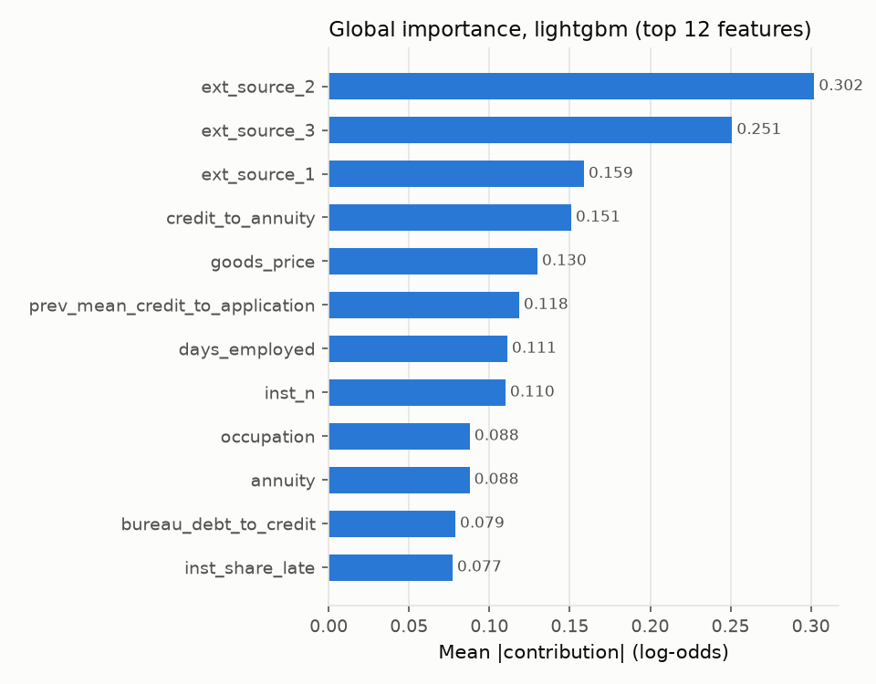
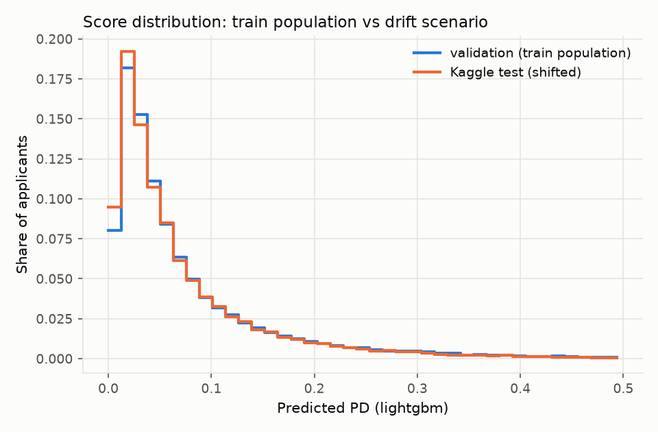

# Model card: Home Credit PD model (champion: `lightgbm`)

_Generated by `scripts/report.py` from `results/credit/hc_challengers/results.json` (run 2026-11-20T23:58:56+00:00) and `results/credit/hc_explain/explain.json` (run 2026-11-21T00:00:01+00:00). Portfolio project, not a production model; no regulatory compliance is claimed._

## 1. Purpose and scope

- **Purpose:** estimate the probability of default (PD) of a consumer-credit applicant at application time, for ranking (approve/decline at a cutoff) and as a PD input to ECL (Module A).
- **Target:** Home Credit `TARGET` (payment difficulties on the loan, as defined by the data provider). Not a Basel default definition.
- **Out of scope:** pricing, limit setting, behavioural scoring, corporate borrowers, any real lending decision.
- **Regulatory context (supports, does not comply):** credit scoring of natural persons is listed as high-risk in EU AI Act Annex III 5(b); GDPR Art. 22 restricts solely automated decisions. The pipeline supports documentation, explainability (reason codes), group monitoring and drift monitoring; it does not implement human oversight, data governance or conformity assessment.

## 2. Data

- Home Credit Default Risk (Kaggle), dbt mart_hc__applicant_features; split: stratified 64/16/20 train/valid/test (no time proxy; documented exception).
- train 196,806 / valid 49,202 / test 61,503; test default rate 0.0807; 61 features (7 categorical).
- Excluded from features: gender (fairness check only).
- History features use only records dated before the application (dbt data tests).
- **Known data issue:** monthly bureau history covers far fewer train than Kaggle-test applicants (see `reports/credit_hc_time_proxy.md`). Modelled explicitly: `bureau_history_status` (no bureau / bureau without history / with history) and `bureau_history_coverage`.
- Population: Home Credit customers (largely un-/underbanked consumers); not a German population.

## 3. Model

- Champion: **lightgbm**, chosen by the pre-set rule *highest valid AUC among challengers* (never on test). Selected params `{"learning_rate": 0.026948927641609742, "num_leaves": 21, "min_child_samples": 38, "reg_lambda": 6.767943238254477, "reg_alpha": 0.7719914976201228, "colsample_bytree": 0.30011546776651277, "subsample": 0.9381622273520457}`, iterations 1981, fit 87.3 s.
- Benchmark: WoE/logistic scorecard (optbinning, monotonic bins, PDO 20 / 600 points at 50:1).

## 4. Performance on test (scored once)

| Metric | Champion | Scorecard |
|---|---|---|
| AUC | 0.7812 | 0.7587 |
| Gini | 0.5625 | 0.5173 |
| KS | 0.4277 | 0.3834 |
| PR-AUC | 0.2744 | 0.2412 |
| Brier | 0.0663 | 0.0679 |
| Calibration slope | 0.9925 | 0.9921 |
| Calibration intercept | 0.0050 | -0.0111 |
| ECE | 0.0041 | 0.0020 |
| ECE after Platt (fit on valid) | 0.0047 | 0.0021 |
| ECE after isotonic (fit on valid) | 0.0048 | 0.0041 |
| Train AUC (overfit check) | 0.8658 | 0.7635 |

ΔAUC champion − scorecard: +0.0226 (95% paired-bootstrap CI [+0.0193, +0.0260]).

## 5. Decision view (illustrative policy: approve 85%, cutoff fixed on valid)

| Group | Approval rate | Default rate among approved | Defaulters declined | Non-defaulters declined |
|---|---|---|---|---|
| all (champion) | 0.853 | 0.0508 | 0.463 | 0.119 |
| F (champion) | 0.878 | 0.0451 | 0.428 | 0.099 |
| M (champion) | 0.804 | 0.0627 | 0.507 | 0.160 |
| all (scorecard) | 0.851 | 0.0537 | 0.434 | 0.124 |
| F (scorecard) | 0.871 | 0.0466 | 0.415 | 0.108 |
| M (scorecard) | 0.813 | 0.0681 | 0.460 | 0.156 |

Gender is not a model input; the table shows outcomes by group only. Differences can come from real risk differences (default rates differ by group) or from proxies; this check does not separate the two and is not a legal fairness assessment.

## 6. Explainability

- Method: TreeSHAP (LightGBM pred_contrib); additivity check max |error| 3.73e-14 logits (base + contributions = model log-odds).
- Top global drivers (mean |contribution|, log-odds): ext_source_2 (0.302), ext_source_3 (0.251), ext_source_1 (0.159), credit_to_annuity (0.151), goods_price (0.130), prev_mean_credit_to_application (0.118), days_employed (0.111), inst_n (0.110).
- Rank agreement of global importance with other models (Spearman): scorecard 0.83, lightgbm_monotone 0.94, catboost 0.94, xgboost 0.98, ebm 0.90.
- Reason codes (top-3 risk-increasing terms) for the 6,895 test applicants declined by both champion and scorecard: same top reason in 0.718 of cases, mean Jaccard of top-3 0.374. Declined-set overlap (Jaccard) 0.609.
- Scorecard reason codes use points lost vs the best bin; champion codes use contributions vs the average applicant (SHAP convention). Both conventions are defensible; they are not identical.

## 7. Stability and monitoring plan

- Score PSI train → Kaggle test (drift scenario): 0.0043; valid → test 0.0005.
- Monthly monitoring (proposed): score PSI and CSI of the top-10 drivers against the development sample; calibration by PD decile once outcomes mature (≥ 12 months); approval-rate and outcome metrics by group.
- **Retraining / review rule (proposed):** score PSI > 0.10 → investigate; > 0.25 → re-validate and consider retraining. CSI > 0.25 on a top-10 driver → data-pipeline check first (the bureau coverage artefact shows that a large CSI can be a data change, not a population change). Observed/predicted default ratio outside [0.8, 1.25] for two consecutive quarters → recalibrate.

## 8. Limitations

- No time dimension: evaluation is a stratified split; out-of-time performance is unknown.
- The Kaggle test population is shifted and unlabelled; performance under that shift is unknown.
- Target definition and population differ from a German retail portfolio; results do not transfer.
- Hyperparameters are selected on one validation split (no nested CV), so the best valid AUC is optimistic; the tuned-vs-grid test comparison is in `reports/credit_hc_tuning.md`.
- Group check covers one attribute and does not test for proxy discrimination.
