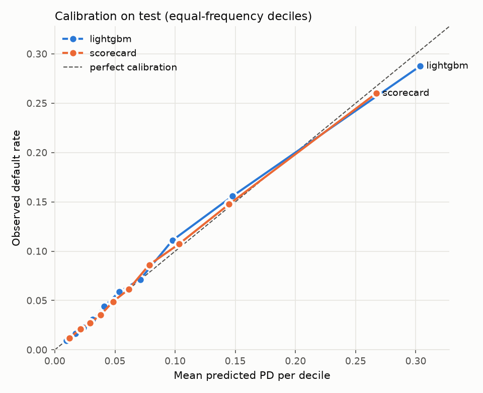

# Model card: Home Credit PD model (champion: `lightgbm`)

_Generated by `scripts/report.py` from `results/credit/hc_challengers/results.json` (run 2026-11-20T18:53:50+00:00) and `results/credit/hc_explain/explain.json` (run 2026-11-20T19:10:34+00:00). Portfolio project, not a production model; no regulatory compliance is claimed._

## 1. Purpose and scope

- **Purpose:** estimate the probability of default (PD) of a consumer-credit applicant at application time, for ranking (approve/decline at a cutoff) and as a PD input to ECL (Module A).
- **Target:** Home Credit `TARGET` (payment difficulties on the loan, as defined by the data provider). Not a Basel default definition.
- **Out of scope:** pricing, limit setting, behavioural scoring, corporate borrowers, any real lending decision.
- **Regulatory context (supports, does not comply):** credit scoring of natural persons is listed as high-risk in EU AI Act Annex III 5(b); GDPR Art. 22 restricts solely automated decisions. The pipeline supports documentation, explainability (reason codes), group monitoring and drift monitoring; it does not implement human oversight, data governance or conformity assessment.

## 2. Data

- Home Credit Default Risk (Kaggle), dbt mart_hc__applicant_features; split: stratified 64/16/20 train/valid/test (no time proxy; documented exception).
- train 196,806 / valid 49,202 / test 61,503; test default rate 0.0807; 61 features (7 categorical).
- Excluded from features: gender (fairness check only).
- History features use only records dated before the application (dbt data tests).
- **Known data issue:** monthly bureau history covers far fewer train than Kaggle-test applicants (see `reports/credit_hc_time_proxy.md`). Modelled explicitly: `bureau_history_status` (no bureau / bureau without history / with history) and `bureau_history_coverage`.
- Population: Home Credit customers (largely un-/underbanked consumers); not a German population.

## 3. Model

- Champion: **lightgbm**, chosen by the pre-set rule *highest valid AUC among challengers* (never on test). Selected params `{"num_leaves": 15, "min_child_samples": 200, "reg_lambda": 5.0}`, iterations 1117, fit 29.7 s.
- Benchmark: WoE/logistic scorecard (optbinning, monotonic bins, PDO 20 / 600 points at 50:1).

## 4. Performance on test (scored once)

| Metric | Champion | Scorecard |
|---|---|---|
| AUC | 0.7795 | 0.7522 |
| Gini | 0.5591 | 0.5045 |
| KS | 0.4208 | 0.3762 |
| PR-AUC | 0.2724 | 0.2265 |
| Brier | 0.0664 | 0.0685 |
| Calibration slope | 0.9701 | 0.9816 |
| Calibration intercept | -0.0442 | -0.0347 |
| ECE | 0.0049 | 0.0027 |
| ECE after Platt (fit on valid) | 0.0049 | 0.0028 |
| ECE after isotonic (fit on valid) | 0.0039 | 0.0041 |
| Train AUC (overfit check) | 0.8591 | 0.7564 |

ΔAUC champion − scorecard: +0.0273 (95% paired-bootstrap CI [+0.0236, +0.0312]).

## 5. Decision view (illustrative policy: approve 85%, cutoff fixed on valid)

| Group | Approval rate | Default rate among approved | Defaulters declined | Non-defaulters declined |
|---|---|---|---|---|
| all (champion) | 0.853 | 0.0516 | 0.455 | 0.119 |
| F (champion) | 0.879 | 0.0455 | 0.424 | 0.099 |
| M (champion) | 0.805 | 0.0643 | 0.495 | 0.161 |
| all (scorecard) | 0.850 | 0.0554 | 0.417 | 0.126 |
| F (scorecard) | 0.871 | 0.0479 | 0.398 | 0.109 |
| M (scorecard) | 0.810 | 0.0707 | 0.441 | 0.161 |

Gender is not a model input; the table shows outcomes by group only. Differences can come from real risk differences (default rates differ by group) or from proxies; this check does not separate the two and is not a legal fairness assessment.

## 6. Explainability

- Method: TreeSHAP (LightGBM pred_contrib); additivity check max |error| 2.31e-14 logits (base + contributions = model log-odds).
- Top global drivers (mean |contribution|, log-odds): ext_source_2 (0.300), ext_source_3 (0.259), goods_price (0.168), ext_source_1 (0.160), credit_to_annuity (0.152), inst_n (0.123), prev_mean_credit_to_application (0.120), days_employed (0.106).
- Rank agreement of global importance with other models (Spearman): scorecard 0.75, lightgbm_monotone 0.94, catboost 0.91, xgboost 0.99, ebm 0.90.
- Reason codes (top-3 risk-increasing terms) for the 6,411 test applicants declined by both champion and scorecard: same top reason in 0.728 of cases, mean Jaccard of top-3 0.418. Declined-set overlap (Jaccard) 0.543.
- Scorecard reason codes use points lost vs the best bin; champion codes use contributions vs the average applicant (SHAP convention). Both conventions are defensible; they are not identical.

## 7. Stability and monitoring plan

- Score PSI train → Kaggle test (drift scenario): 0.0037; valid → test 0.0004.
- Monthly monitoring (proposed): score PSI and CSI of the top-10 drivers against the development sample; calibration by PD decile once outcomes mature (≥ 12 months); approval-rate and outcome metrics by group.
- **Retraining / review rule (proposed):** score PSI > 0.10 → investigate; > 0.25 → re-validate and consider retraining. CSI > 0.25 on a top-10 driver → data-pipeline check first (the bureau coverage artefact shows that a large CSI can be a data change, not a population change). Observed/predicted default ratio outside [0.8, 1.25] for two consecutive quarters → recalibrate.

## 8. Limitations

- No time dimension: evaluation is a stratified split; out-of-time performance is unknown.
- The Kaggle test population is shifted and unlabelled; performance under that shift is unknown.
- Target definition and population differ from a German retail portfolio; results do not transfer.
- Small tuning grids; the gain over the scorecard may grow slightly with more tuning, which would not change the conclusions on calibration and stability.
- Group check covers one attribute and does not test for proxy discrimination.
